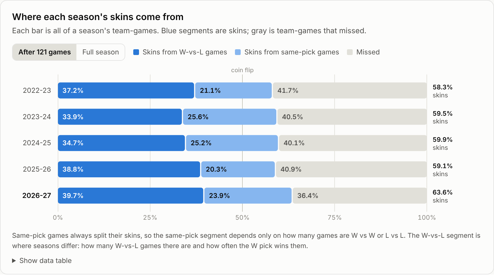
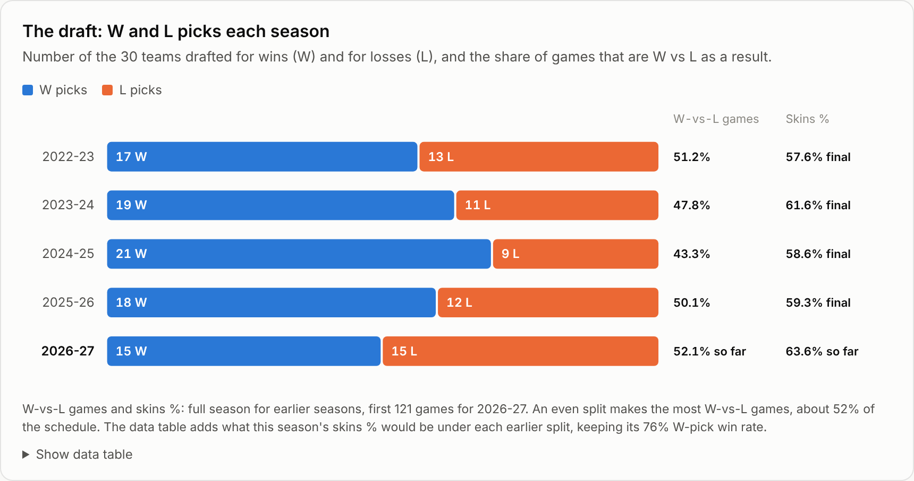
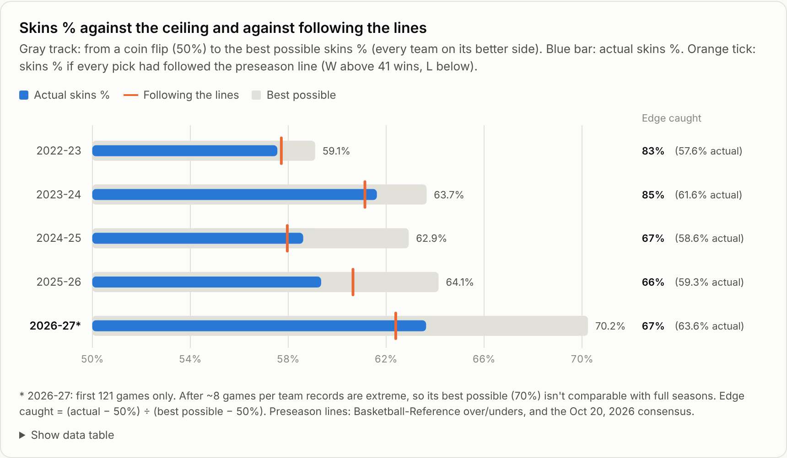
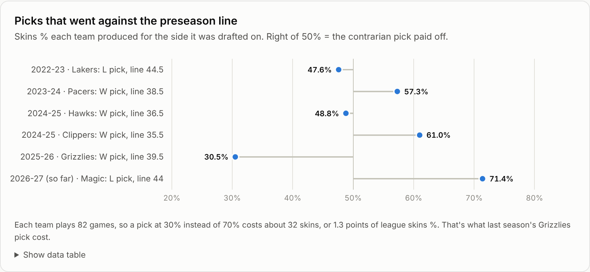
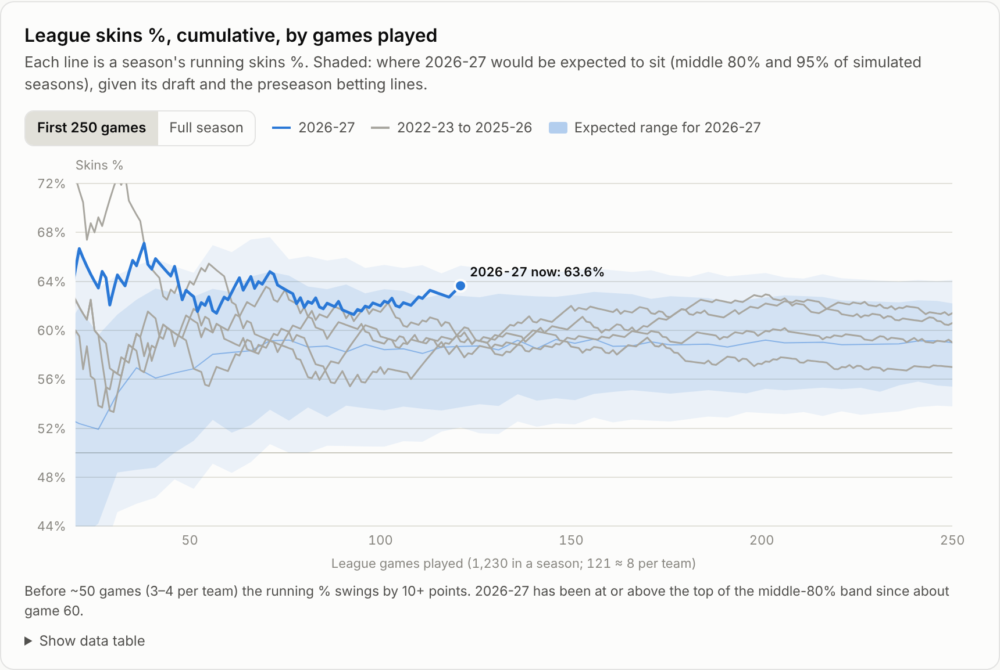
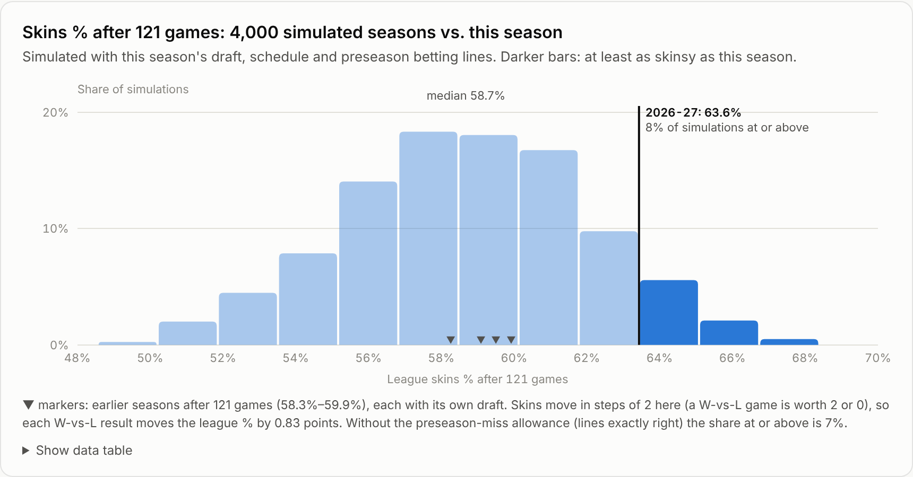
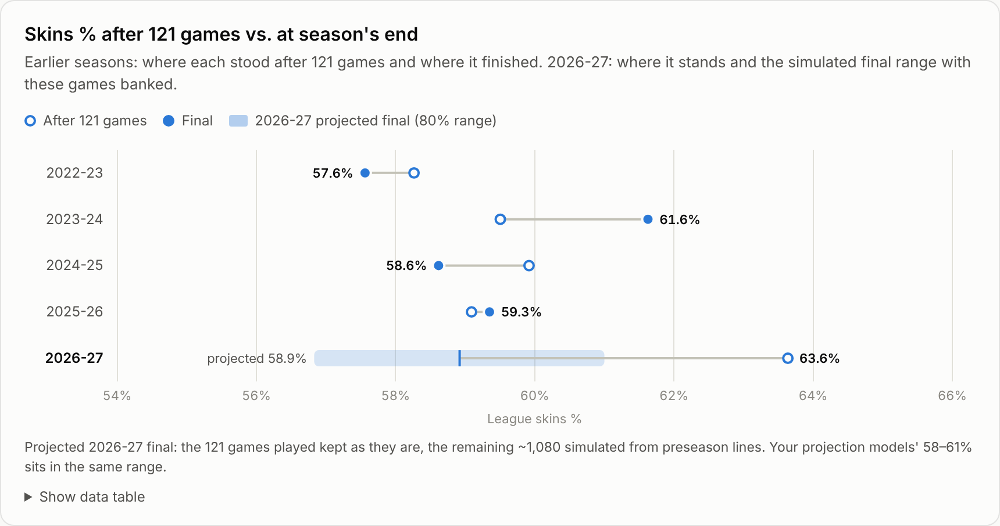
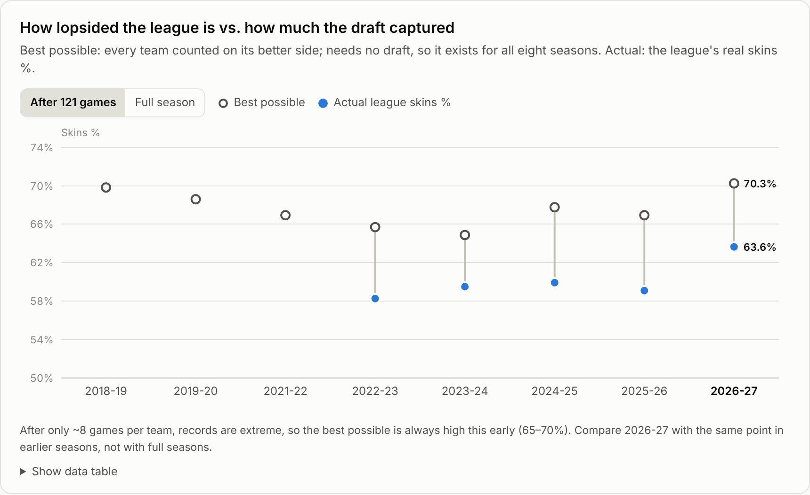
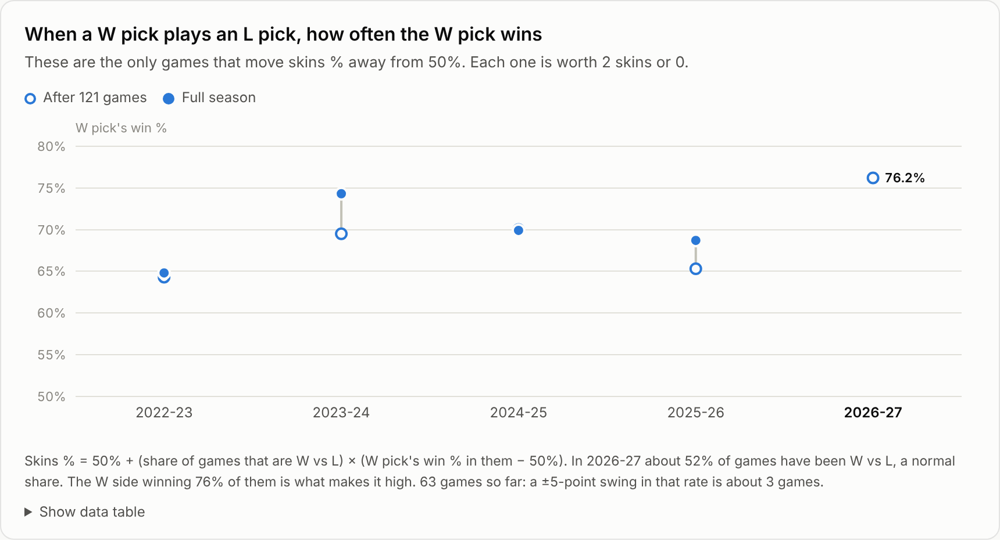
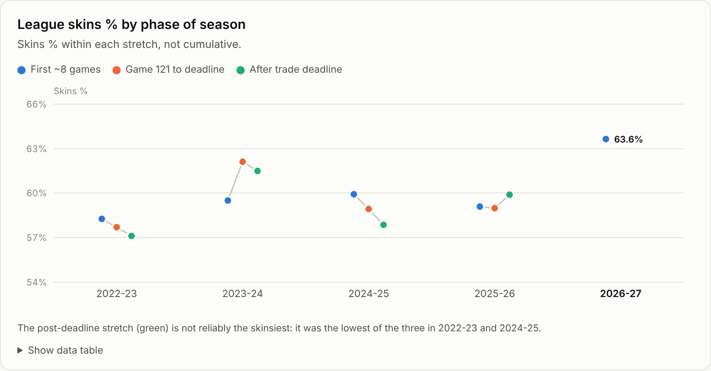

# How skinsy is each season? (as of Nov 5, 2026)

League-wide skins % is the share of all team-games where the drafted outcome happened: a W pick won or an L pick lost.
After 121 games, 2026-27 is at **63.6%**. The four earlier seasons finished at 58–62%, and the projection models expect 58–61% this season.

Open `skins_report.html` for the interactive version, with hover details, data tables, and light and dark mode. Static images are in `charts/`.

## Findings

- **63.6% is high, but luck can produce it.** I simulated 4,000 seasons using this season's draft, its actual schedule and the preseason betting lines, with each line allowed to be wrong by a typical amount.
  63.6% or more after 121 games came up in **8%** of them, about 1 in 12. The median was 58.7%.
  If the lines were exactly right, it would be 7%.
- **It barely moves the finish.** Keep the 121 games as played and simulate the other ~1,080 from the preseason lines: the projected final is **58.9%** (80% range 56.8–61.0%).
  That matches the models' 58–61%.
  After 121 games, each of the last four seasons was within about 2 points of its final: 58.3→57.6, 59.5→61.6, 59.9→58.6, 59.1→59.3.
- **Both ingredients ran hot.** Skins % depends on how lopsided the league is and how much of that the draft captures.
  - **How lopsided:** the best possible skins %, with every team counted on its better side, is 70.3% after 121 games. That's the highest of eight seasons at this point (2018-19: 69.8%; others 64.9–68.6%). This matches the tanking report: the bottom of the league is unusually deep right now.
  - **How much the draft captured:** about 67% of that edge over 50%, against 53–64% at this point in 2022-26.
- **The mechanism.** A game between two W picks or two L picks always splits the skins 1–1. Only W-pick-vs-L-pick games move skins % off 50%, by 2 skins or 0:
  - skins % = 50% + (share of games that are W vs L) × (W pick's win % in those games − 50%)
  - This season 52% of games have been W vs L, a normal share.
  - The W pick has won **76%** of them, against 64–70% at this point in 2022-26. That's 63 games, so 5 points is about 3 results.
- **The trade deadline doesn't make the skins game skinsier.** Post-deadline skins % was below the game 121-to-deadline rate in 3 of 4 seasons:

  | Season | First 121 games | Game 121 to deadline | After deadline |
  |---|---|---|---|
  | 2022-23 | 58.3% | 57.7% | 57.1% |
  | 2023-24 | 59.5% | 62.1% | 61.5% |
  | 2024-25 | 59.9% | 58.9% | 57.9% |
  | 2025-26 | 59.1% | 59.0% | 59.9% |

  Tanking makes the league more lopsided, but it only adds skins when the tanking teams were drafted as L picks.
  A W pick that sells off at the deadline costs its owner skins.

- **The draft's W/L split adds a little.** This season's 15–15 split is the most even yet (17–13, 19–11, 21–9 and 18–12 before).
  An even split makes the most W-vs-L games, about 52% of the schedule.
  Keeping this season's 76% W-pick win rate, last season's 18–12 split would give 63.0% instead of 63.6%, and 2024-25's 21–9 split would give 61.4%.
  The split is the drafters' choice: L went on all 13 teams with preseason lines under 41 wins, plus Portland (41.2) and Orlando (44.0).
  It isn't a sign of a lopsided league: preseason lines had 16 teams over 41 (17–19 before), and 13 teams have winning records (11–14 at this point before).

- **2022-23 was the least skinsy season, but not because of bad drafting.** Its draft caught 83% of the available edge, second only to 2023-24 (85%).
  The league itself was flat: the best possible skins % (every team on its better side) was 59.1%, the lowest of all eight seasons.
  The weakest drafting was in 2024-25 and 2025-26 (66–67%), whose lopsided leagues covered for it.
- **The drafts nearly always follow the preseason lines.** Only one or two teams a season went against them.
  Following the lines exactly would have given 57.7%, 61.1%, 58.0% and 60.7%, almost the same as the actual skins % each year.
  Contrarian picks have been mixed. The worst was last season's Grizzlies W pick (30.5% skins), which cost about 1.3 points of league skins %.

**Bottom line:** mostly randomness, plus a genuinely lopsided start to the season.
The excess is about 1-in-12 luck, it's spread over only 121 games, and it should mostly wash out by April.












## Method

- **Skins:** rebuilt from ESPN game results (`../tanking-2026-27/games.csv`) with each season's W/L picks.
  Picks for 2022-26 come from `archive/history/rosters_and_finals_2022-26.csv`; the 2026-27 draft is read from `index.qmd`.
  The rebuilt finals (57.6%, 61.6%, 58.6%, 59.3%) match the page's 58/62/59/59.
  The NBA Cup final is removed: ESPN lists it as a regular-season game, but it doesn't count in the standings. With it removed, the rebuilt finals match the league's records exactly.
- **Simulation:** each team's strength is its Oct 20, 2026 consensus win total converted to a point margin, (W − 41) ÷ 2.7.
  Each simulated season adds a fresh 3.2-point miss per team, which is the 8.6-win preseason miss from this repo's model.
  Home edge (1.75 points) and per-game spread (14.0 points) are fit on 2025-26.
  Games use this season's actual schedule from `schedule_2026-27.csv`. NBA Cup games without set opponents are left out, so the simulated season is 1,200 of 1,230 games.
- **Rebuild:**

  ```bash
  python3 fetch_schedule.py
  ```

  ```bash
  python3 skins_data.py
  ```

  ```bash
  python3 build_report.py
  ```

  To include newer games, first rerun `../tanking-2026-27/fetch.py ../tanking-2026-27/games.csv`.
